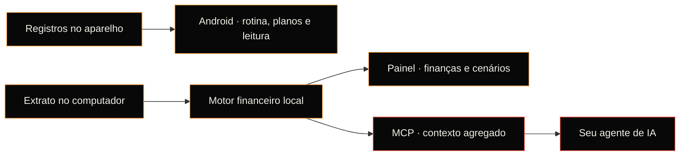

<p align="center">
  
</p>

<h1 align="center">FinTips</h1>
<p align="center"><strong>Seus planos. Seu contexto. No seu aparelho.</strong></p>

<p align="center">
  <a href="https://github.com/CabriniJr/FinTips/actions/workflows/portao.yml"></a>
  <a href="https://github.com/CabriniJr/FinTips/releases/tag/android-v0.6.0-alpha.3"></a>
  <a href="docs/PORTE-KOTLIN.md"></a>
  <a href="docs/PRIVACIDADE.md"></a>
  <a href="LICENSE"></a>
</p>

<p align="center">
  <a href="#android">Baixar Android</a> ·
  <a href="#veja-em-ação">Demonstrações</a> ·
  <a href="#comece-no-computador">Início rápido</a> ·
  <a href="#documentação">Documentação</a> ·
  <a href="CONTRIBUTING.md">Contribuir</a>
</p>

FinTips reúne **rotina, leitura, planos de vida e finanças pessoais** para dar
contexto às suas decisões. Você escolhe as metas; o app guarda os registros e
calcula o progresso; seu agente de IA investiga, pergunta e ajuda a entender as
alternativas. As decisões continuam sendo suas.

O foco é **Android**. A interface tem a linguagem de instrumentos de *Neon
Genesis Evangelion*: preto, alto contraste, tipografia condensada, painéis
chanfrados e movimento que responde ao toque. Os dados pessoais ficam no client.

## Veja em ação

<table>
  <tr>
    <th align="center">Seu dia, em movimento</th>
    <th align="center">Um ritmo realista de leitura</th>
  </tr>
  <tr>
    <td align="center">
      <picture>
        <source media="(prefers-reduced-motion: reduce)" srcset="docs/media/hoje.png">
        
      </picture>
    </td>
    <td align="center">
      <picture>
        <source media="(prefers-reduced-motion: reduce)" srcset="docs/media/leitura.png">
        
      </picture>
    </td>
  </tr>
  <tr>
    <td align="center">Checks, progresso e transições entre abas.</td>
    <td align="center">Histórico, previsão e ajustes no seu ritmo.</td>
  </tr>
</table>

<p align="center"><sub>
Interface embarcada no APK, gravada no Chromium com dados fictícios.
Não são capturas de um aparelho Android.
<a href="docs/media/README.md">Origem e reprodução</a> ·
<a href="docs/media/hoje.png">Hoje sem animação</a> ·
<a href="docs/media/leitura.png">Leitura sem animação</a>
</sub></p>

## O que cabe aqui

| | No FinTips |
|---|---|
| **Seis áreas da vida** | Força, Movimento, Saúde, Estudos, Foco e Finanças, com tarefas e planos próprios. |
| **Rotina diária** | Tarefas recorrentes, histórico por dia e progresso baseado no que foi registrado. |
| **Livros e aprendizado** | Posições de leitura, importação local do Librera e previsão a partir do histórico. |
| **Planos com motivo** | Intenção, próximo passo e prazo. O porquê acompanha a decisão. |
| **Finanças pessoais** | Motor local com OFX, categorias, reserva, compromissos, metas, cenários e projeções. |
| **Contexto para o agente** | Servidor MCP local para investigar e registrar decisões com proveniência. |

**Nada é verdade sem proveniência.** Uma importação ou heurística ajuda a
investigar; uma conclusão exige decisão do usuário ou do agente, com motivo.
Dado ausente aparece como ausência, sem inventar progresso ou fracasso.

## Android

<p>
  <a href="https://github.com/CabriniJr/FinTips/releases/download/android-v0.6.0-alpha.3/FinTips-Android-v0.6.0-alpha.3.apk"><strong>↓ Baixar APK — alpha 3</strong></a>
  &nbsp;·&nbsp;
  <a href="https://github.com/CabriniJr/FinTips/releases/tag/android-v0.6.0-alpha.3">Notas, código-fonte e checksums</a>
</p>

A alpha é uma build de avaliação com a interface web embarcada em WebView.
Você já pode testar tarefas, áreas da vida, planos e leitura. **As finanças do
motor local ainda não estão disponíveis nesse APK**; use o painel no computador
para essa parte. A migração da tela para Compose está em andamento.

O APK não tem permissão `INTERNET`, analytics ou backup automático. Os registros
ficam no aparelho; **desinstalar apaga os dados**. Faça uma cópia local antes de
remover o app. Baixe APKs pelas releases e confira `SHA256SUMS.txt`.

[Todas as releases](https://github.com/CabriniJr/FinTips/releases) ·
[Guia de avaliação](docs/APK-AVALIACAO.md) ·
[Como a build é publicada](docs/RELEASES-ANDROID.md)

## Comece no computador

Pré-requisito: **Python 3.10+**. O repositório inclui o painel compilado;
Node só é necessário para desenvolver a interface.

```bash
git clone https://github.com/CabriniJr/FinTips.git
cd FinTips
python3 -m venv .venv
source .venv/bin/activate           # Linux, macOS ou WSL
pip install -e ".[tudo]"
fintips init
fintips serve
```

Abra **http://127.0.0.1:8420**. Para trazer as finanças, importe seu extrato pela
aba Dados ou use `fintips ingest caminho/do/extrato.ofx`.
O workspace padrão é `~/Documents/FinTips`, fora do repositório.

[Comandos e Docker](docs/GUIA-TECNICO.md) ·
[Jornada de uso](docs/JORNADA.md) ·
[Desenvolvimento no Windows](CONTRIBUTING.md#ambiente)

## Seu agente, com contexto

O servidor **MCP local** fornece ferramentas para investigar gastos, simular
regras, comparar escolhas e registrar decisões com o motivo. Há um plugin do
Claude no repositório e configuração para Claude Desktop e Claude Code:

```bash
fintips mcp-config                 # configuração para Claude Desktop
fintips mcp-config --claude-code   # comando de registro no Claude Code
```

A conexão nativa com **ChatGPT** faz parte do objetivo do projeto; ainda não
está disponível na alpha Android. O contrato do contexto e seus limites estão
em [Arquitetura](docs/ARQUITETURA.md) e [Privacidade](docs/PRIVACIDADE.md).

## Privacidade como arquitetura

- **PII fica no client.** Extratos, nomes, títulos de livros e planos pessoais
  não entram no Git. O agente recebe agregados, não o extrato bruto.
- **Você controla os registros.** A interface salva localmente e oferece
  cópias locais; não depende de uma conta no FinTips.
- **Origem acompanha o número.** Informado por você, importado ou estimado são
  estados diferentes. O app guarda essa diferença.

Usar um agente externo compartilha o contexto agregado com o cliente de IA
escolhido. O [modelo de privacidade](docs/PRIVACIDADE.md) detalha essa fronteira.

## Para onde vai

| Frente | Estado |
|---|---|
| Tarefas, planos e leitura no Android | Disponíveis na alpha de avaliação. |
| Motor financeiro e MCP local | Disponíveis no computador; porte Kotlin em andamento. |
| UI nativa em Compose | Em desenvolvimento. |
| Scores por área e agregado | Contratos e motor; integração visual nativa em andamento. |
| Tempo de uso e atividade física | Discovery documentado; coleta automática ainda pendente. |
| Librera cloud, TotalPass e ChatGPT nativo | Integrações planejadas; ainda não conectadas no APK. |

A direção é reduzir o registro manual e fazer o contexto entrar naturalmente
na rotina, com permissões explícitas e processamento no client.
[Automação](docs/AUTOMACAO-SEM-TOIL.md) · [Android primeiro](docs/ANDROID-PRIMEIRO.md)

## Como funciona



O **Python é a referência funcional**. O motor Kotlin Multiplatform é conferido
contra arquivos de ouro gerados pelo Python. O destino é Kotlin e Compose no
Android; cada porte precisa manter a paridade.

[Arquitetura](docs/ARQUITETURA.md) · [Porte Kotlin](docs/PORTE-KOTLIN.md) ·
[Guia técnico](docs/GUIA-TECNICO.md)

## Documentação

| Quero… | Começar por… |
|---|---|
| Testar no celular | [Avaliação Android](docs/APK-AVALIACAO.md) |
| Entender o produto e os objetivos | [App de vida](docs/APP-DE-VIDA.md) · [Jornada](docs/JORNADA.md) |
| Conhecer o modelo de dados e o agente | [Arquitetura](docs/ARQUITETURA.md) · [Guia técnico](docs/GUIA-TECNICO.md) |
| Entender como meus dados são protegidos | [Privacidade](docs/PRIVACIDADE.md) |
| Explorar automação e conectores | [Automação](docs/AUTOMACAO-SEM-TOIL.md) · [Librera](docs/LEITURA-LIBRERA.md) · [Open Finance](docs/OPEN-FINANCE.md) |
| Usar a identidade visual | [Kit de marca](docs/identidade/README.md) · [Linguagem visual](docs/LINGUAGEM-VISUAL.md) · [Movimento](docs/MOVIMENTO-UI.md) |
| Compilar, testar ou contribuir | [Contribuição](CONTRIBUTING.md) · [Porte Kotlin](docs/PORTE-KOTLIN.md) · [Releases](docs/RELEASES-ANDROID.md) |

## Contribua

Bugs, ideias e PRs são bem-vindos. Leia [CONTRIBUTING.md](CONTRIBUTING.md) para
preparar o ambiente, executar o portão de qualidade e trabalhar nas frentes
ativas. Demonstrações e issues devem usar **dados fictícios**, sem anexar
extratos, backups ou planos pessoais.

[Reportar um bug](https://github.com/CabriniJr/FinTips/issues/new) ·
[Ver trabalho aberto](https://github.com/CabriniJr/FinTips/pulls) ·
[Coordenação entre agentes](docs/ENTRE-AGENTES.md)

---

<p align="center">
  <picture>
    <source media="(prefers-color-scheme: light)" srcset="docs/identidade/logo-claro.png">
    
  </picture>
  <br><sub>Código sob <a href="LICENSE">MIT</a> · Barlow Condensed sob <a href="web/src/fonts/OFL.txt">SIL OFL</a></sub>
</p>
