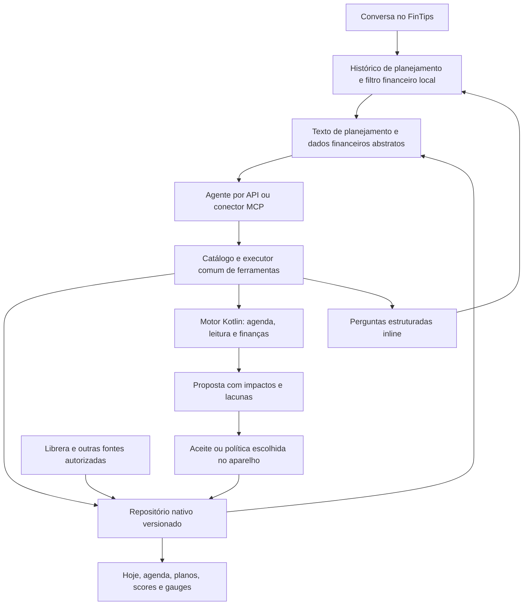

# Agente de vida: conversa, planejamento e execução

Status: plano de execução proposto em 16/10/2026, a partir da main `2d6981b`.
Fronteira de privacidade revisada no mesmo dia após esclarecimento do usuário.
Este documento especifica o destino; **não declara o agente completo disponível
na preview 12**. As previews 10/11 já persistem extratos e separam fluxos;
a preview 12 adiciona guarda comum e fonte Librera persistente. Ainda não
integram o motor financeiro completo nem o gestor semântico desta experiência. Os
schemas/exemplos anexos são contratos de projeto, ainda sem endpoint anunciado.
Substitui a direção da triagem por rascunhos de mensagens.

## Resultado que define o produto

A pessoa descreve uma intenção. O agente entende o objetivo, consulta o que já
existe, pergunta apenas por decisões relevantes, decompõe o trabalho, simula
capacidade e propõe um conjunto coerente. Ao aceitar, objetivos, etapas,
atividades, agenda e recursos são preenchidos de uma vez. Novas evidências
alimentam o progresso e o replanejamento, dentro dos limites escolhidos.

**Mensagem não é plano. Resposta a uma pergunta não é outro objetivo.**
“Vamos organizar isso”, uma saudação, uma correção e um cancelamento podem
produzir zero alterações. Um parágrafo com três intenções pode produzir três
objetivos relacionados, com títulos próprios, sem copiar o parágrafo para eles.
O histórico completo continua local e separado dos artefatos.

A inteligência tem duas partes: o agente interpreta, decide o que perguntar e
propõe; o motor local calcula e valida. Contratos tornam esse trabalho
acoplável a agentes diferentes. Eles não produzem compreensão sozinhos.

## Diagnóstico do que existe

| Camada | Evidência na main | Lacuna para esta experiência |
|---|---|---|
| Entrada do chat | `web/src/triagem-chat.jsx`, `respond` | chama `makeDraft`/`splitIntents` antes da IA; uma mensagem comum já recebe tipo e título |
| Interpretação | `triagem-model.js`, `triagem_agente.py`, `AgenteTriagem.kt` | regras e léxico fechado; API recebe rascunhos/projeção, sem uma sessão semântica completa |
| Operações do agente | protocolo `fintips_agente_v2` | preenche referências e vínculos, mas não oferece o ciclo consultar → decompor → simular → agendar → revisar |
| Vida e agenda | `life-store.js`: `inicio` e `repetir` booleano | tarefa diária/pontual; não há sessões com duração, dias alternados e orçamento semanal |
| Leitura | pacing e, na preview 12, `LibreraFonte`/`LibreraJobService` | fonte persistente e job atualizam os mesmos livros; agenda e replanejamento do agente continuam pendentes |
| Guarda | preview 12: `EstadoCliente`, `native-storage.js`; `ExtratosLocais` preservado | bundle/chat migrados para autoridade atômica nativa com CAS; tipos/consultas futuros exigem evolução com migrador; Workspace desktop mantém sua guarda |
| Finanças | `plans.py`, `projection.py`, `profile.py`, `score.py` e portes | regras existem, mas o dispatcher Android expõe apenas parte; cadastro genérico no caderno não alimenta projeção financeira |
| MCP Android/ponte | `ServidorLocal.kt`, `integracoes/ponte/` | consulta readonly reduzida; não expõe propostas/agenda/cenários deste plano |
| Visualização | UI móvel e renderer Compose de gauges | bons componentes, mas faltam os dados/contratos integrados para alimentar o painel pretendido |

Os testes anteriores provaram transporte, limites e transações. Uma API
simulada que devolve os campos esperados **não prova** que um agente entende
um parágrafo real. O aceite passa a incluir qualidade semântica e uso contínuo.

## Pilar prioritário: extrato, registros e motor financeiro existente

Reforço do usuário em 16/10/2026: essas informações sustentam a avaliação do
passado e do que cabe fazer no futuro. Registrar o OFX e mostrar somas mensais
é a entrada. O perfil, os scores e as projeções precisam vir da cadeia
financeira já funcional em Python, dos registros e das escolhas declaradas.
**A integração dessa base passa à frente da jornada completa de certificação.**

Fluxo: fontes locais → canônico → classificação/decisões → enriquecimento →
motor financeiro/perfil/objetivos → projeção de contexto protegida → agente e UI.
O cálculo local funciona sem uma conta de IA. O agente interpreta os números,
investiga lacunas, correlaciona, compara alternativas e propõe decisões; ele
não substitui as fórmulas por uma nota calculada em texto livre.

A fonte de referência é [`report.analyze`](../fintips/report.py). A composição
reutiliza sua sequência, contratos e portes existentes, em vez de transformar
`statement_context.py` num segundo motor. O parser isolado deixa fluxo/categoria
com defaults; chamar `baseline`/`calcularScore` nesse extrato ainda não
classificado daria aparência de análise a dados semanticamente incorretos.

Mapeamento auditado nesta revisão, **não um registro runtime paralelo**:

| Resultado existente | Referência e porte disponível | Uso no app/agente |
|---|---|---|
| Base mensal e capacidade financeira | `analysis.py` / `Analise.kt` | renda/despesa/sobra já classificadas, meses considerados e estabilidade |
| Score financeiro e componentes | `score.py` / `Score.kt` | explicar resultado, dimensões e próximos pontos usando a mesma fórmula |
| Perfil e retrato | `profile.py` / `Perfil.kt` | separar o observado, o sugerido e o que a pessoa declarou; visão integrada antes de aconselhar |
| Execução e viabilidade de planos | `plans.py` / `Planos.kt` | quanto falta, aportes e competição entre objetivos |
| Projeção e reserva | `projection.py` / `Projecao.kt` | cenário com premissas, horizonte e impacto nos demais planos |
| Causas, decisões e objetivos | `causes.py`, `decisions.py`, `objetivos.py`; `Causas.kt`, `vida/Objetivos.kt`; auditar decisões e adaptadores faltantes | motivos/alternativas registrados, compromisso, checks e evidências de progresso |
| Contexto curto com acesso ao detalhe | `report.para_agente`, `DETALHE_EM` | aproveitar o mecanismo existente de resumo com ponteiro, não inventar outro contexto desconectado |

A existência desses portes **não prova** que a cadeia inteira está ligada no
Android. Classificação, regras, entidades, compromissos, lojas e composição do
relatório precisam de auditoria de entrada a saída. Trecho ainda sem porte ou
adaptador é lacuna de integração a fechar com ouro, não uma heurística na UI.
O catálogo definitivo deriva dos descritores canônicos; esta tabela só orienta
a revisão atual e não alimenta capacidades anunciadas.

O resumo da preview 10 (`financas_importadas`) não permite inferir salário,
despesa real, reserva disponível ou perfil. A fonte completa fica preservada
para alimentar os adaptadores. Importações de meses/contas diferentes exigem
períodos e saldos coerentes; não somar saldos de extratos sobrepostos nem fazer
média dos scores de cada conta. Qualquer agregação nova tem referência e ouro
próprios nos dois motores. Começar com o caso já coberto e declarar a cobertura.

### A importação precisa abrir a visão financeira que já funcionava

Esclarecimento do usuário: depois de importar, o app deve oferecer reserva,
scores, análise dos tipos de compra e otimizações. **O recibo da importação e
o contexto para a IA não substituem a experiência financeira visível.** O
painel básico entra com F-base, sem esperar o refinamento de P9; compras e
alavancas fazem parte da recuperação, não de uma futura funcionalidade opcional.

No código atual, `web/src/main.jsx` abre `NativeFinance` para qualquer rota
financeira no Android e restringe os componentes antigos ao caminho não Android.
Portanto há duas lacunas: compor/expor o motor e reconectar os consumidores
visuais e suas ações ao transporte nativo. Não basta remover o desvio: os
componentes antigos chamam a API HTTP Python em consultas e escritas; cada
operação precisa do adaptador Android correspondente, sem fallback de rede
silencioso e sem fórmulas de domínio no React.

Estas são referências auditadas para o aceite, não uma nova lista de
capacidades runtime; capacidades reais continuam derivadas dos contratos:

| Visão após importar | Comportamento a recuperar | Referência existente e lacuna Android |
|---|---|---|
| Panorama | score financeiro com suas cinco dimensões e maior ganho; reserva em meses, poupança, sobra, despesa, comprometimento e fluxo mensal | `Overview` em `views.jsx`; `report.analyze`, `Score`, `Analise`; depende da cadeia classificada e patrimônio/contexto |
| Reserva e previsões | alvo, quanto falta, quando fecha no cenário, evolução e planos consumindo a mesma sobra | `ForecastView`, `projection.project` / `Projecao`; manter horizonte, patrimônio e premissas coerentes |
| Tipos de gasto e compras realizadas | categorias da pessoa, distribuição/recorrência, histórico consultável e gastos invisíveis | `Spending`, `Data`, `analysis.invisible_spending`, `taxonomy`; heurística/invisíveis e consultas ainda exigem integração/porte |
| Intenção de compra | prudência, sinais de risco, custo em meses de sobra, efeito na reserva e em cada plano, estratégias de pagamento/espera | `Plans`/`avaliar_compra`, `purchases.evaluate` / `Compras`; o porte declara `contexto_pessoal` e `precedentes` fora do escopo atual, a recuperar com referência/ouro |
| Compromissos e oportunidades | definido separado de candidato; alavancas com valor mensal, score antes/depois e efeito no prazo da reserva/metas | `Fixed`, `LeversView`, `commitments.py`, `levers.calcular`; composição/portes ainda faltantes, não substituir por frases genéricas |
| Visão integrada do agente | números, cobertura, relações, perfil assinado/sugerido e acesso ao detalhe de qualquer bloco | `report.para_agente`, `dossier.montar`, ferramentas MCP Python; portar/compor o que falta e aplicar a projeção de saída também a correlações/observações |

O score geral e o `score_prudencia` de uma intenção são resultados diferentes.
A distribuição por categoria é valor/frequência/histórico; não existe motivo
para inventar uma nota universal por categoria e chamá-la de regra antiga.
Uma intenção de compra exige item/preço (e condições relevantes), que podem
vir da conversa ou de um artefato existente. Não fabricar intenções a partir
de cada lançamento nem inferir arrependimento confirmado de sinais heurísticos.
A triagem prioriza lacunas que mudam a análise, com perguntas inline.

Uma otimização é um cenário recalculado: mostrar o valor da mudança, premissas,
resultado anterior e resultado simulado. A pessoa/agente avalia se faz sentido;
consultar o cenário não altera compromissos ou planos. Preservar unidades
(reais, pontos, meses), horizonte e cobertura. Valores ainda indisponíveis
mostram a dependência exata e reaproveitam os registros já importados.

Aceite visível: importar uma base sintética com classificação e registros
suficientes → abrir Panorama sem reiniciar ou importar de novo → navegar pelos
blocos acima → fechar/reabrir sem perder fontes → mudar uma classificação ou
premissa e ver revisão/resultado atualizados. Comparar reserva, score e
compra com a referência Python, e conferir que uma alavanca produz os mesmos
efeitos ao recalcular o motor. Fazer isso no Android, não só na API Python ou
em bridge simulado. Consultas de contexto do agente refletem a mesma revisão
com identidade financeira protegida; não enviar o dossiê bruto ao transporte.
Entregas parciais podem chegar antes, identificadas como tal; F-base não está
completa enquanto essa visão continuar substituída pelo resumo de importação.

### O que prova essa integração

- Mesma base sintética classificada, regras, patrimônio, perfil/compromissos,
  planos, objetivos e data de avaliação → mesmos resultados na referência
  Python e na composição Kotlin. Ouro de cada módulo continua obrigatório;
  acrescentar um caso da **cadeia integrada**, com o arredondamento contratado.
- Alterar um registro/regra/metas dispara novo cálculo local e nova revisão de
  contexto. Painel, agente por API e MCP consultam os mesmos resultados, com
  proteção da identidade financeira na saída, sem contas pessoais no relay.
- Perfil estatístico/sugerido não vira personalidade declarada. Causas e
  decisões vêm dos registros/pessoa/agente, não são deduzidas do extrato.
- Score existente mantém fórmula, pesos e arredondamentos já testados. Campos
  de cobertura explicam zeros/defaults do contrato legado; não mudar a fórmula
  para fingir ausência nem apresentar uma lacuna como fracasso da pessoa.
- Histórico apresenta observações e retratos calculados locais com período,
  revisão da base e versão da regra. Comparar passado e presente distingue
  mudança de comportamento, novo dado e nova fórmula. Não inventar score de
  uma data sem insumos suficientes para reconstruí-lo.
- Projeção identifica premissas/limitações e considera metas concorrentes;
  reserva não é simplesmente saldo bancário. O agente explica trade-offs, e
  a pessoa escolhe prioridades e autoriza alterações.
- Lacuna relevante vira pergunta inline que aproveita os dados existentes;
  não exigir cadastrar novamente o que o extrato e os registros já fornecem.

## Experiência alvo: três jornadas

Os exemplos abaixo são sintéticos; não são cópias de registros pessoais.

### Certificação e estudo

Entrada: “Quero uma certificação de observabilidade. Preciso fazer o curso,
praticar e ler dois livros. Quero uma rotina que caiba na semana.”

1. Consultar perfil declarado, objetivos ativos, livros/progresso, recursos
   relacionados e capacidade de tempo já escolhida. Reutilizar os registros.
2. Identificar um objetivo de certificação e seus recursos. Se não houver
   currículo confiável, pedir uma referência ou marcar a decomposição como
   proposta genérica; não inventar módulos oficiais, requisitos ou exame.
3. Perguntar o que muda o planejamento: por exemplo, prazo ou tempo semanal.
   Se já estiver definido, não perguntar novamente. Oferecer alternativas
   inline; uma janela livre não significa vontade de estudar nela.
4. Propor etapas de estudo, prática, simulados e revisão, com pré-requisitos,
   esforço estimado e critério de conclusão. Estimativa do agente é hipótese.
5. Distribuir sessões na agenda, sem sobrepor compromissos ou outros objetivos.
   Exibir o total semanal e as trocas: mais tempo, prazo maior ou menor escopo.
6. Um aceite autoriza o conjunto. Hoje apresenta a próxima sessão; Planos
   apresenta etapas, recursos e projeção; o calendário mostra as sessões.
7. Conclusão do curso não prova aprovação na certificação. Simulados, presença,
   posição do livro e domínio do conteúdo têm evidências distintas.

### Terminar livros e ajustar o ritmo

O agente consulta a biblioteca antes de pedir título/porcentagem. Um livro já
conectado vira recurso do objetivo; não cria outro por estar citado no chat.

- Progresso observado vem da fonte, com timestamp original e frescor.
- Restante em pontos-base é distribuído pelas **datas de sessões efetivamente
  planejadas**, inclusive em dias alternados, até o prazo escolhido.
- Exemplo sintético: 40% lido, 6 sessões restantes → 10 pontos percentuais por
  sessão. Essa meta é uma proposta; não significa 10 páginas ou 10 minutos.
- Sem velocidade medida, percentual não vira minutos. O tempo pode ser um
  orçamento escolhido; a relação percentual/minuto fica em calibração.
- O pacing existente continua sendo o cálculo observado. A distribuição por
  sessões concretas é uma operação nova, com versão e ouro próprios; não
  alterar silenciosamente a fórmula antiga baseada em dias de calendário.
- Se o prazo não couber, o agente explica e oferece alternativas. Não agenda
  esforço impossível nem muda a meta para esconder atraso.
- A posição do Librera pode recalcular metas futuras dentro de política
  aceita. Não cria sessões concluídas, compreensão ou dias lidos por inferência.

### Comprar um carro sem ignorar os outros planos

O agente consulta capacidade financeira, reserva, compromissos, perfil
**declarado**, objetivos concorrentes e qualidade/frescor dessas informações.

Simula manter o plano atual e alternativas de compra/prazo/entrada/parcelas,
incluindo custos de posse conhecidos. Seguro, impostos, manutenção e uso
faltantes são lacunas ou hipóteses explícitas, nunca custo zero silencioso.

A simulação usa o mesmo motor local e horizonte para todos os planos: compara
reserva, fluxo mensal, aportes e datas previstas. Não atribui a mesma sobra
integral a cada objetivo nem conta dinheiro reservado duas vezes. O agente
explica impactos e preferências declaradas; não deduz personalidade pelo extrato.

A recomendação qualitativa pertence ao agente e cita números/premissas do
motor. A escolha continua sendo da pessoa. Guardar um plano não contrata
financiamento, faz compra nem movimenta conta.

## Arquitetura comum a API e MCP

### 1. Repositório local único

Migrar a autoridade dos registros para um repositório nativo transacional.
Escolha proposta: Room/SQLite no Android, atrás de uma interface Kotlin;
regras e DTOs continuam no motor comum, sem dependência Android. Fixar a versão
compatível com Kotlin/AGP/SDK no PR da guarda, não adotar um major por suposição.

A UI e workers usam o mesmo repositório. O WebView conserva apenas cache de
apresentação. O bridge oferece consultas/commands tipados e invalidação por
revisão, sem expor SQL ou caminhos ao JavaScript. O executor verifica a origem
local confiável; navegação/link externo não ganha acesso ao bridge. A primeira migração valida uma cópia completa, grava numa
transação, marca versão e permite exportar/recuperar o legado. Depois do corte,
todos os editores passam pelo executor; não há dual-write com `localStorage`.

Guardar documentos de domínio, observações imutáveis, relações, sessões,
versões, propostas, recibos e outbox de integrações. Alterações de estado e
outbox são atômicas; exportar para agenda externa usa retry idempotente.
Chaves e grants de arquivos ficam nos adaptadores, fora de backups comuns.

### 2. Modelo de domínio consultável

| Artefato | Papel e relações |
|---|---|
| Objetivo | resultado escolhido, prioridade, prazo e critério de sucesso |
| Plano | estratégia/revisão que organiza etapas para um objetivo |
| Etapa | parte do plano, pré-requisitos e critério verificável |
| Atividade | trabalho executável, estimativa, frequência e evidência esperada |
| Sessão | ocorrência concreta com duração, fuso, data e estado |
| Recurso | livro/curso/material; identidade local reutilizável |
| Observação | medida da fonte/pessoa, instante/período, unidade e frescor |
| Perfil/regra | preferência ou restrição declarada, proveniência e validade |
| Plano financeiro | adaptador real do motor de planos, não apenas nota no catálogo |
| Cenário/decisão | hipótese, resultados, alternativas e escolha com justificativa |
| Política de ajuste | limites aceitos para reorganização automática e seu histórico |

Os 14 tipos atuais são ponto de partida. Novos tipos e campos entram pelo
catálogo, com schema, operações, unidades, privacidade e adaptador real. O
manifesto anuncia somente capacidades implementadas/autorizadas. “Conhecer os
artefatos” significa poder descobrir e consultar esses contratos; não despejar
todo o banco num prompt nem criar um formulário por tipo. **Todo artefato do
app precisa estar disponível como contexto**, com a projeção financeira já
definida; não restringir a visão ao formulário, rascunho ou aba em foco.

Cada relação tem semântica: `parte_de`, `depende_de`, `usa_recurso`, `apoia`,
`agenda` ou `mede`. Progresso dos filhos não é somado em duplicidade no pai.
O ID do livro é reutilizado no estudo e no objetivo de leitura.

### 2.1. Visão geral e contexto de todos os artefatos

Requisito do usuário: os agentes precisam enxergar o conjunto da vida registrado
no FinTips, suas relações e consequências. O app não escolhe silenciosamente
um subconjunto de tipos para deixar visível à IA. A restrição financeira
abstrai campos protegidos e mantém valores/contexto; não esconde uma área inteira.

O contrato de contexto tem três níveis, disponíveis no mesmo executor API/MCP:

1. **Panorama inicial global:** objetivos/prioridades, planos em andamento,
   orçamento de tempo e dinheiro, próximos compromissos/prazos, livros e ritmo,
   perfil/regras declaradas, indicadores, conflitos e decisões pendentes.
   Acompanha catálogo de todos os tipos, contagens, revisão, fontes e lacunas.
   Consultá-lo ao abrir/retomar uma sessão de planejamento, mesmo que a pessoa
   esteja em uma tela específica. Não depende de já existir um rascunho.
2. **Consulta completa dos artefatos:** listar, buscar, obter detalhes, percorrer
   relações e consultar histórico/observações por tipo, área, estado, período
   ou referência. Inclui concluídos/pausados e conversas/decisões anteriores
   pertinentes; não apenas itens ativos ou resultados de busca textual.
3. **Atualizações:** consultar mudanças desde uma revisão, inclusive remoções,
   fontes atrasadas e decisões alteradas. Invalidar resumos/resultados derivados
   afetados; o agente atualiza o contexto antes de recomendar ou propor.

Paginação e orçamento de tokens organizam a leitura, sem tornar o restante
inacessível. Toda página declara contagem, escopo, cobertura e cursor. Panorama
pode resumir detalhes, mas mantém todos os domínios visíveis e informa o que
não foi carregado. Não devolver uma lista truncada como se fosse o banco todo,
nem interpretar artefato fora da página como inexistente. Fontes sem acesso,
adaptadores pendentes e áreas sem dados têm estados distintos.

O [contrato proposto do contexto](contratos/agente-contexto-v1.schema.json)
e seu [exemplo sintético](contratos/exemplos-contexto/01-panorama-paginado.json)
explicitam essa separação. São desenho de interface, ainda sem endpoint.
Detalhes usam os mesmos valores tipados do contrato de turno. Campos textuais
de planejamento permanecem legíveis; identidade financeira usa referências.

Todo tipo persistido precisa de adaptador de consulta/projeção e política por
campo. Catálogo/cobertura derivam do registro canônico (`contracts.DEPOSITOS`
e descritores de domínio), sem lista paralela na UI. A composição reutiliza
`report.analyze`/`contexto_de_perfil` e seus equivalentes portados; não criar
outro cálculo financeiro dentro do agregador de contexto. Criar um artefato novo inclui registrá-lo no catálogo e no contexto no
mesmo PR. O portão de implementação compara registro canônico e catálogo:
tipos/campos esquecidos são falha de cobertura, não silêncio no prompt. Os
schemas de design ainda não implementam esse portão semântico.

Referências, páginas, relações e simulações pertencem à mesma revisão/grant.
Se a base mudou, renovar snapshot ou recusar explicitamente; não juntar uma
agenda antiga com a projeção financeira atual. É possível começar uma nova
sessão sem perder a visão dos registros e decisões persistidos. O histórico
é dado para o agente, nunca instrução para ampliar permissão ou executar comandos.

Exemplos de aceite: ao propor mais estudo, consultar os outros objetivos e a
carga já reservada; ao propor um carro, considerar todos os planos financeiros,
não só o plano aberto; ao encontrar um livro concluído fora da primeira página,
reutilizá-lo como recurso sem duplicá-lo. Um conector pode ter escopo reduzido,
mas o contexto precisa declarar essa limitação; não alegar visão global nesse caso.
A leitura global autorizada não concede escrita automática.

### 3. Diálogo e propostas separados dos registros

Uma sessão guarda mensagens, respostas estruturadas, decisões pendentes,
resumo privado e referências às fontes. Não guarda cada fala como rascunho.

Resultados de um turno: `sem_alteracao`, `perguntar`, `propor` ou
`indisponivel`. Uma proposta é um conjunto revisável de comandos; só o executor
aplica aos artefatos. O agente pode substituir/cancelar propostas pendentes,
sem apagar registros confirmados ou histórico. Correções voltam à mesma sessão.

Perguntas têm ID, texto contextual, motivo, campo/decisão afetada, tipo de
resposta e opções quando úteis. Perguntar somente o que muda a decisão; de uma
a três perguntas relacionadas por interação, permitindo adiar. Uma resposta
curta é interpretada no contexto da pergunta, não como novo plano.

O resumo mostra títulos curtos, etapas, horas semanais, sessões e impactos.
Ajustes são conversados. Detalhes técnicos são inspecionáveis, sem configurar
contratos, pesos ou conectores a cada objetivo.

A recuperação dos planos já criados na preview 9 também é uma proposta: o
agente identifica candidatos a unir, dividir e renomear, preserva conclusão,
prazos, vínculos e proveniência, mostra o antes/depois e permite desfazer.
Nunca apagar automaticamente o legado porque parece uma fala longa.

### 4. Executor e catálogo de capacidades

[Contrato proposto do turno](contratos/agente-turno-v1.schema.json) e
[exemplos sintéticos](contratos/exemplos-agente/) tornam o desenho revisável.
O schema valida forma; não substitui validação do catálogo, semântica ou PII.

| Serviço comum proposto | API local | Ferramenta MCP proposta |
|---|---|---|
| Catálogo, versões e capacidades | `catalogo.obter` | `fintips_catalogo` |
| Panorama global, revisão, catálogo e cobertura | `contexto.obter` | `fintips_contexto` |
| Listar/buscar/detalhar todos os tipos e históricos | `artefatos.consultar` | `fintips_artefatos` |
| Percorrer relações entre domínios | `artefatos.relacoes` | `fintips_relacoes` |
| Mudanças/remoções desde a revisão | `contexto.alteracoes` | `fintips_alteracoes` |
| Registrar turno/resposta | `dialogo.responder` | texto de planejamento permitido; identidade financeira substituída localmente |
| Preparar/revisar proposta | `propostas.preparar` | `fintips_propor` |
| Simular capacidade e agenda | `agenda.simular` | `fintips_simular_agenda` |
| Calcular ritmo/restante | `leitura.ritmo` + distribuição por sessões | `fintips_ritmo_leitura` |
| Comparar cenários financeiros | `financas.simular` | `fintips_simular_financas` |
| Consultar métricas e cobertura | `indicadores.consultar` | `fintips_indicadores` |
| Validar e consultar proposta/recibo | `propostas.validar/status` | `fintips_proposta` |
| Aplicar com autoridade do aparelho | `propostas.aplicar` interno | aprovação local; não recebe `confirmado=true` como prova |

Esses nomes são proposta de interface, não rotas existentes. API de modelos
usa tool/function calling e um adaptador de mensagens; MCP usa `tools/list` e
`tools/call`. Ambos delegam ao mesmo executor e schema, sem regras financeiras
ou de agenda duplicadas em prompts/adaptadores.

Cada chamada traz versão, contexto/revisão, request ID e grant/capacidade. O
aparelho emite aliases e associa ao snapshot e escopo. Uma referência antiga
não pode ser reinterpretada para outro item após reordenar a lista. Contexto
vencido, alteração concorrente ou ampliação de escopo exigem atualização.

Orçamento de chamadas/tempo/tokens, cancelamento, tool results tipados e
recuperação de erro pertencem à sessão. Worker de arquivo não faz chamadas
pagas por polling; mudanças simples recalculam indicadores localmente.

### 5. Fronteira de privacidade: identidade financeira, contexto preservado

Esclarecimento de 16/10/2026: a abstração desejada se concentra no extrato,
especialmente na **origem e no destino exatos**. Valores podem ser enviados.
Planos de estudo e intenções de compra podem chegar ao agente com seu texto e
significado. A proposta anterior de abstrair toda conversa foi ampla demais.

| Conteúdo | Fronteira de saída para a IA |
|---|---|
| Objetivos, planos de estudo, cursos, livros, produtos e intenções de compra | texto significativo permitido no contexto pertinente ao planejamento |
| Perguntas/respostas de planejamento, prazos e orçamento de tempo | permitido; histórico relevante acompanha a sessão |
| Valores financeiros, categorias e relações | permitido, com unidade e referências quando necessário |
| Identidade da origem/destino financeiro: contraparte, favorecido, pagador, estabelecimento real e dados de conta | apenas alias emitido no aparelho; mapa fica local |
| OFX/CSV bruto, memo bancário original, comprovantes e identificadores de transação | locais; projetar somente os campos autorizados |
| Credenciais, chaves, documentos pessoais e caminhos privados | locais; não são liberados pela permissão para planos |

Com o assistente ativo, o agente por API pode receber o histórico relevante de
planejamento e artefatos como títulos de objetivos/livros/cursos. Isso permite
interpretar intenções, criar títulos curtos, decompor etapas e fazer perguntas
contextuais. Não exigir que a pessoa classifique ou autorize cada frase, nem
converter nomes de cursos/livros/produtos em palavras opacas.

A fronteira financeira é aplicada **antes** do transporte, no executor comum:
projetar campos por proveniência e sensibilidade; substituir identidades por
aliases vinculados ao contexto; manter valores/unidades/categorias. Um nome
protegido não pode sair escondido em `titulo`, `descricao`, `porque`, erro ou
resultado de ferramenta. Marcar a tela inteira como “planos” não libera um
campo copiado do extrato. A proteção acompanha a origem do campo, inclusive
quando ele é relacionado a um objetivo ou reapresentado na conversa.

Texto misto com dados bancários precisa passar pela mesma proteção. Importação
de extrato/comprovante continua pelo caminho local; não usar o chat como upload
bruto. Identidades financeiras conhecidas, inclusive citadas na conversa,
usam o mapa local. Trecho bancário sem projeção confiável fica local para
resolução, sem bloquear a parte de estudo/compra já autorizada. Não alegar que
regex ou um prompt de redação detectam qualquer identidade desconhecida.

O catálogo informa a política por campo: `texto_planejamento`,
`valor_financeiro`, `identidade_financeira_local` ou `segredo_local`, por
exemplo. Campo financeiro desconhecido é fechado por padrão. Resultados do
agente podem gerar texto de planejamento, mas não reclassificar campos
protegidos ou mudar a proveniência para escapar da fronteira.

**Modelo local é opcional.** Pode ser uma evolução para uso offline ou para
quem escolher um modo mais privado. Não é pré-requisito para a triagem por API,
não bloqueia o ThinkPhone e não exige download de pesos para criar um plano.
A compreensão passa a usar o contexto autorizado no agente escolhido, com
contratos e ferramentas; não o léxico limitado da preview 9.

API e MCP usam essa mesma política no executor. No conector, FinTips controla o
que ele próprio envia; texto digitado diretamente no ChatGPT/Claude já está
nessa plataforma. O banco canônico e mapas ficam no aparelho. Envio autorizado
à API é processamento externo; não implica publicar registros no Git, criar
um banco pessoal no relay ou prometer retenção zero no provedor.

### 6. Autoridade e revisão

Um aceite do plano autoriza criar o conjunto de artefatos e sessões. A pessoa
pode escolher uma política para ajustes futuros: redistribuir sessões na
semana, preservar prazo/prioridade e respeitar teto de esforço. Ajustes dentro
desses limites podem ser automáticos, visíveis e reversíveis; exceções voltam
como uma decisão inline, sem confirmação diária de dados observados.

MCP remoto ganha uma capacidade nova de **propor**, separada da consulta atual.
Não ampliar grants readonly existentes em silêncio. A aprovação ocorre no
aparelho, vinculada ao hash da proposta, escopo e revisão; um modelo não pode
se autoaprovar passando um booleano. Conferir permissão em cada chamada,
independentemente das annotations MCP. Propostas têm TTL, IDs idempotentes e
recibos; retry não duplica tarefas ou sessões.

O relay atual precisa de allowlist/protocolo versionados para essas operações.
Não é apenas trocar o prompt ou publicar as ferramentas Python completas.
Continuar sem banco pessoal/snapshot no relay. Testar API e MCP com o SDK,
inclusive cliente sem capacidade, replay, offline, cancelamento e revogação.

## Librera: um agendamento Android sobre a fonte escolhida

A base desta seção foi implementada na preview 12 com SAF/JobScheduler e
`EstadoCliente`; [uso, cobertura e limites](LIBRERA-AUTOMATICO.md). Os aceites
do agente/agenda abaixo continuam exigindo as demais fases.

O equivalente ao “cron lendo o path” é **WorkManager + URI persistente**, com
seleção única pelo Storage Access Framework. Não exige digitar um path nem
permissão para todos os arquivos. Preferir a pasta sincronizada acessível,
resolvendo `app-Progress.json` a cada execução; sincronizadores podem substituir
o arquivo e invalidar uma URI de arquivo antiga. Provedor precisa oferecer e
manter o grant; pasta privada de outro app não fica acessível por suposição.

- Atualizar ao retomar, após conectar e em trabalho periódico único por fonte.
  Proposta inicial: 30 min com flex; Android exige pelo menos 15 min e pode
  atrasar por Doze/bateria. Não usar polling permanente ou alarme exato.
- Abrir somente o arquivo esperado na árvore escolhida, com limite de tamanho,
  timeout e parser compartilhado. Não varrer documentos pessoais.
- Persistir apenas projeção mínima do parser: identidade local do livro,
  perfil, `p`, `t` e proveniência. Descartar `pt` e outros extras.
- Deduplicar pela identidade e timestamp/conteúdo da fonte. Repetir o mesmo
  JSON amanhã não cria outra observação nem prova que a pessoa leu amanhã.
- Falha/revogação/arquivo parcial preserva histórico, marca fonte atrasada e
  permite reconectar uma vez. Última tentativa/sucesso e data do dado são distintos.
- Primeiro plano e worker usam a mesma transação/repositório. Pausa/desconexão
  cancelam trabalho e impedem novas gravações, inclusive job que já estava lendo.
- Diretório local sincronizado funciona sem API cloud do FinTips. Um documento
  de provedor cloud depende do provedor/rede; não assumir autorização Drive de
  outro app nem prometer que conceder URI sincroniza o conteúdo por si só.

Aceite em Android: escolher a fonte uma vez, fechar app, mudar o arquivo,
executar worker/retomar e ver o progresso real nas telas. Repetir após reinício,
com snapshot igual, acesso revogado, JSON truncado, dado antigo e dois coletores.

## Agenda e replanejamento

Começar com agenda interna: orçamento semanal, janelas, duração, frequência,
pré-requisitos, datas concretas, fuso e bloqueios. “Dia sim, dia não” precisa de
âncora contínua; não reiniciar a alternância toda segunda-feira.

Calendário Android é uma fonte/saída opcional: ler disponibilidade local sem
exportar títulos; escrever somente em calendário escolhido/gerido pelo app,
com permissão explícita e IDs idempotentes. Uma proposta interna não deve
aparecer como evento externo antes de ser aceita.

O planejador local detecta conflitos, excesso de carga, prazo inviável,
dependências circulares e falta de evidência. O agente explica alternativas;
o motor não ajusta horários/dinheiro por uma opinião escondida no prompt.
Datas locais e instantes usam fuso explícito, inclusive DST e mudanças de fuso.
Passado e sessões concluídas não são reescritos em um replanejamento.

## Scores, gráficos e gauges alimentados pelo motor

Indicadores separados: progresso do objetivo, constância/comprometimento,
viabilidade da agenda, ritmo de leitura, situação financeira e cobertura dos
dados. O agregado usa metas/pesos escolhidos pela pessoa, não um julgamento
sobre sua vida. A recomendação do agente não cria uma fórmula de score.

Cada indicador carrega janela, versão da regra, origem, frescor, cobertura e
componentes incluídos/omitidos. Novos indicadores sem base usam
`null`/“Sem dados”. Fórmulas legadas preservam seus zeros/defaults com cobertura
explícita; não reinterpretá-los como avaliação completa da pessoa.
Planejado, estimado e observado aparecem separadamente. Não somar percentual,
minutos e reais nem contar livro + sessão + objetivo pai três vezes.

A definição de fórmulas novas é um PR próprio com referência Python, porte
Kotlin e ouro. Scores financeiros existentes são reutilizados sem alteração
silenciosa. Mudança de pesos/metas vale com nova revisão e não melhora o passado.

UI: Hoje com próximas sessões e progresso real; agenda semanal de carga;
objetivo com etapas/recursos; livro com posição, meta por sessão e previsão;
cenário financeiro comparativo mostrando efeito nos outros planos. Gauges e
transições respondem a snapshots reais, com alto contraste, legenda além da
cor, TalkBack e movimento reduzido. Gráfico de projeção é identificado como tal.

## Execução por PRs, com dependências e saída verificável

| PR/ID | Entrega | Dependência | Pronto quando |
|---|---|---|---|
| P0 | Separar mensagem de artefato e recuperação do legado | nenhuma | saudações/correções/respostas não viram planos; falta de agente mantém mensagem, não inventa cadastro; reorganização do legado é proposta reversível |
| P1 | Catálogo global, contexto, comandos e estado de diálogo/proposta | P0 | todos os tipos/áreas descobríveis, panorama e consulta paginada/histórico/relações; exemplos passam em schemas; noop legítimo; capacidades pendentes explícitas |
| P2 | Guarda nativa e migração | P1 | UI/executor/worker compartilham revisão/transação; legacy/backup/quota/crash/concorrência exercitados; instalação por cima preserva registros |
| P3 | Projeção financeira e contexto de planejamento | em paralelo a P1/P2 | texto de estudo/compra chega inteligível à IA; valores preservados; identidade da origem/destino e dados bancários brutos não saem, inclusive em mensagens mistas e tool results |
| F-base | Integrar a cadeia financeira existente ao Android/contexto | P1/P2/P3 e adaptadores; prioridade antes de P6 | classificação/regras/enriquecimento → relatório/perfil/scores/projeção, compras e alavancas com ouro; painel pós-importação e agente leem a mesma revisão |
| P4 | Librera persistente | P2 | uma seleção, atualização sem reimportar com app fechado/reaberto/reiniciado; timestamp/dedup/revogação comprovados |
| P5 | Agente por tools e perguntas inline | P1, P2, P3 (sem dependência de modelo local) | sessão carrega visão geral, aprofunda contexto de qualquer artefato e cruza domínios; entende intenção/correção; não copia conversa para títulos nem repete perguntas |
| P6 | Certificação + livro + agenda | P4, P5; F-base prioritária | objetivo → etapas → sessões sem sobrecarga → metas por leitura → observação atualiza o mesmo plano; teste completo na UI Android |
| P7 | Propostas pelos dois transportes | P1, P2; ampliar junto a P5/P6 | mesma chamada via API/MCP dá o mesmo resultado; scopes/proposta/aprovação/recibo funcionam; conector real comprovado após hospedagem/autorização |
| P8 | Carro + comparação de alternativas financeiras | F-base, P5 | cenários com mesma base, reserva/custos e efeito nos demais planos; notas do catálogo não são tratadas como cálculo |
| P9 | Painéis, scores e refinamento visual | P6, P8 + fórmulas com ouro | refina painéis financeiros já entregues em F-base; gauges/gráficos de vida usam dados reais/versionados; cobertura visível e avaliação sem transcrição diária |

O catálogo e a conformidade API/MCP nascem em P1; P7 entrega a extensão real
do transporte remoto. Não deixar “MCP comum” como uma adaptação posterior do
prompt. **F-base é fundação prioritária**, não deve esperar P8 ou P9: é o
motor do retrato financeiro e do contexto. P8 entrega a experiência conversacional
de alternativas de compra sobre essa base; o estudo avança sem empurrá-la para o fim.

Faixa Codex: diálogo, UI, agenda e integração Android/guarda/fontes. Claude
aceitou domínio/contratos, registro/projeção de saída, contexto do motor e
adaptadores de perfil, planos, projeção e scores, conforme `ENTRE-AGENTES.md`.
Compartilhados têm escopo registrado antes de edição. Cada regra nova nasce
em Python/Kotlin no mesmo commit, com ouro, conforme `CLAUDE.md`.

## Portões de qualidade e demonstração

1. Casos sintéticos com parágrafos, várias intenções, saudação, pergunta,
   correção, cancelamento, negação, prazo relativo, recurso existente e lacuna.
   Comparar **grafo esperado e efeitos**, não apenas validade JSON ou título literal.
2. Evals com agente real e orçamento controlado, separadas de mocks. Registrar
   modelo/versão, resultado e fonte sintética; não solicitar chave na conversa
   nem usar registros pessoais no CI. Mock testa protocolo, não inteligência.
3. Ouro Python/Kotlin de agenda, pacing, cenários e indicadores. Contrato
   financeiro antigo continua idêntico até PR explícito de mudança de regra.
4. Mesmo executor via adaptador API e MCP/SDK: consultar, simular, propor,
   aprovar no aparelho e consultar recibo. Negativos de escopo/replay/stale/offline.
5. Android real/emulador: migração sem perda, SAF/reboot, worker sem WebView,
   fonte parada/revogada, economia de bateria e apresentação móvel/acessível.
6. Cobertura global: todos os tipos/campos canônicos têm política/adaptador;
   percorrer páginas recupera todos os registros autorizados, com relações e
   histórico. Exercitar concluído fora da página, domínio sem fonte, novo tipo,
   mudança concorrente e restrição de grant. API/MCP dão a mesma visão.
7. Uso prolongado: objetivo escolhido e fonte conectada; dias seguintes usam
   leitura/agenda normalmente, sem cadastrar tarefas e percentuais de novo.
   Medir localmente transcrições, perguntas repetidas e intervenção exigida.

Não publicar outra “triagem inteligente” apenas porque compila ou porque um
stub devolve três registros. O primeiro aceite financeiro é F-base, com
paridade da cadeia integrada; P6 valida a jornada de estudo e P8 a decisão
financeira conversacional. Os passos podem ser entregues em PRs menores, com capacidade/estado honestos em cada build. P0 não se resolve apenas
desligando a triagem: o corte precisa preservar mensagens e legado, e a build
não pode anunciar o agente completo enquanto P3/P5/P6 não estiverem provados.

## Próxima revisão e evidências exigidas

A decisão de produto está definida: agente que preenche artefatos e reduz toil.
As escolhas técnicas abaixo exigem evidência de execução; não são configurações
que cada pessoa precisa resolver para criar uma meta:

- P3: projeção por campo/proveniência, aliases estáveis no contexto e proteção
  de mensagens mistas. Conferir os corpos HTTP/MCP reais com dados sintéticos:
  títulos de estudo/compra e valores presentes; identidades financeiras ausentes.
  Benchmark de modelo local deixa de ser dependência desta entrega.
- P2: biblioteca/versão de guarda e migração dos quatro stores, incluindo
  catálogo, conversa e recibos. Validar restauração antes de remover a autoridade antiga.
- P4: provedor e localização acessíveis do JSON Librera, sobrevivência do grant
  e substituição do arquivo pelo sincronizador. Um caminho de exemplo não prova acesso real.
- P5/P7: modelo remoto configurável, contratos de ferramentas admitidos,
  autenticação/hospedagem do conector e limites de execução. Só declarar
  ChatGPT/Claude conectado depois do teste nas contas reais autorizadas.

Cada PR registra o resultado dessas decisões e suas limitações. Os exemplos
estruturais anexos podem avançar sem resolver hardware/hospedagem; não são
motivo para anunciar o agente pronto.

## Fontes e documentos relacionados

- [Automação sem toil](AUTOMACAO-SEM-TOIL.md) e [Librera](LEITURA-LIBRERA.md).
- [Scores e fontes](SCORES-FONTES-CONECTORES.md), [porte](PORTE-KOTLIN.md),
  [ponte MCP atual](../integracoes/ponte/README.md).
- Android: [SAF e grants persistentes](https://developer.android.com/training/data-storage/shared/documents-files),
  [WorkManager periódico](https://developer.android.com/reference/androidx/work/PeriodicWorkRequest),
  [guarda Room](https://developer.android.com/training/data-storage/room).
- [MCP: ferramentas, schemas e annotations](https://modelcontextprotocol.io/specification/2025-06-18/server/tools).
  Referência de protocolo consultada em 16/10/2026; escolher/revalidar a versão
  efetivamente negociada pelos clientes no PR do transporte.
