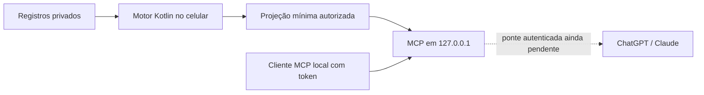

# Servidor MCP no próprio celular

A direção do usuário é **servidor local no Android**. A preview 6 embarca
motor e transporte MCP Kotlin no APK; não exige hospedar o motor ou os
registros num serviço externo. O piloto Node anterior permanece referência,
não é dependência da sessão local.



## Como usar esta build

1. Atualize o APK por cima da alpha anterior; package e assinatura permanecem.
2. Em **Contexto → Servidor IA local**, escolha as áreas e revise o JSON.
3. Autorize a atualização dessas áreas ao usar o FinTips e inicie o servidor.
4. Para um cliente MCP capaz de fazer chamadas locais, copie o endereço e o
   token. Transporte Streamable HTTP; header `Authorization: Bearer <token>`.
5. A tela só mostra **MCP local verificado** depois de inicializar, listar as
   ferramentas e consultar o contexto por três chamadas ao socket real. Use
   **Testar servidor neste celular** para repetir a verificação.
6. Encerre pelo app ou pela notificação. A sessão, o contexto em memória e o
   token são revogados. Uma nova sessão possui outra porta e outro token.

O token só é copiado por ação explícita. Não entra no JSON da UI, no contexto
MCP, em arquivos, backups ou logs. No Android 13+, o clipboard é marcado como
sensível. O endereço atende somente `127.0.0.1`, não o IP do Wi-Fi.

A notificação é solicitada quando a pessoa inicia o servidor pela primeira
vez. Se negada, o Android ainda pode manter o foreground service no gerenciador
de apps ativos; o botão do FinTips sempre permite encerrá-lo. A tela oferece
acesso às configurações da notificação. Não há inicialização no boot ou restart
sticky. O serviço pode continuar ao trocar de app, mas Android/OEM pode matar
o processo; não é disponibilidade permanente.

## O que está funcionando e o que falta

| Caminho | Estado |
|---|---|
| Motor Kotlin na UI | frentes do dia, pacing e conferência OFX existentes |
| Servidor MCP no Android | Kotlin, loopback, token por sessão, controle foreground |
| Consulta de contexto reduzido | `ler_contexto_revisado`, somente leitura |
| Atualização local | ao mudar tarefas, leitura, retomar o app e periodicamente enquanto visível; só áreas aprovadas |
| Troca de áreas | pausa e omite contexto até nova revisão explícita |
| Fonte inválida ou contexto sem atualização há 1 h | ferramenta informa indisponibilidade, sem base inventada |
| ChatGPT e Claude nas contas do usuário | ainda pendentes de ponte/túnel e consulta real |
| Túnel ou envio automático a servidor externo | não implementados e não ativados |

Os conectores remotos fazem chamadas pela infraestrutura dos provedores;
abrir o app ChatGPT ou Claude no mesmo telefone não dá a eles acesso direto
a `127.0.0.1` do Android. **Servidor no celular e caminho até a IA são partes
separadas.** A futura ponte deve encaminhar chamadas ao aparelho, validar
cliente/usuário e deixar a projeção filtrada antes da saída; não deve mover o
workspace para um servidor público.

OpenAI documenta **Secure MCP Tunnel**, com saída HTTPS e sem listener público,
para superfícies suportadas. Exige configuração de organização/workspace,
permissões e chave de runtime. Não foi validado como cliente embarcado Android
e não demonstra suporte ao Claude. Como o objetivo é **um MCP para ambos**,
a escolha da ponte continua pendente; não publicar URL local como se fosse
um conector já utilizável dentro dos chats.

## Diagnóstico da preview 6

O usuário reportou falha na preview 5. O teste instrumentado da base passou
em um emulador Android 14 com KVM no Actions; isso não reproduz nem descarta
a falha do aparelho do usuário. A tentativa local sem KVM atingiu timeout ao
inicializar o WebView e não serve como comprovação do serviço.

A preview 6 elimina a confirmação baseada apenas em socket aberto: o início
só confirma depois do handshake, descoberta e consulta MCP. Se a sonda inicial
falhar, a sessão é encerrada. O teste manual fica disponível enquanto há
contexto válido e a sessão não está pausada. Revogação não aguarda a sonda;
resultado de uma geração antiga não confirma a sessão nova.

O erro agora atravessa ResultReceiver e ponte WebView com mensagens fixas.
Não serializar `exception.message`, stacktrace, contexto ou token para a UI.
A tela informa versão da build e API Android para conferir o APK instalado.

| Código | Significado |
|---|---|
| MCP-00 | Ação local não concluída; motivo não classificado |
| MCP-01 | Android recusou iniciar o serviço |
| MCP-02 | Contexto recusado antes de iniciar |
| MCP-03 | Falha ao abrir a sessão/socket local |
| MCP-04 | MCP não respondeu corretamente ao teste local |
| MCP-05 | Confirmação não chegou no prazo; conferir estado |
| MCP-06 | Sessão indisponível para teste |

Se o canal nativo não existir no APK, a tela pede atualização do WebView/Chrome
em vez de dizer apenas para instalar outro APK. Para investigar o relato no
aparelho, solicitar código e build exibidos; nunca pedir token ou contexto.

## Fronteira de privacidade

A projeção continua sendo a mesma allowlist da preview 4: estados por área,
estados do ritmo e fontes. Sem nomes, títulos, valores financeiros, datas,
contagens, IDs de registros, lista de apps, arquivos ou texto livre. Campos
extras são recusados antes de atualizar a sessão. Indicadores reduzidos ainda
revelam rotina e não são apresentados como anônimos.

O servidor não lê arquivos, não conhece o workspace e não expõe o motor de
escrita. A UI lê o armazenamento privado e invoca os cálculos existentes.
`SessaoLocal` impede ampliar/remover escopos por atualização automática,
pausa a consulta durante revisão e recusa atualizações de gerações anteriores.
Falha de fonte invalida o contexto; recuperação exige dados válidos, não zero.

A variante **debug** agora declara INTERNET, FOREGROUND_SERVICE,
FOREGROUND_SERVICE_SPECIAL_USE e POST_NOTIFICATIONS. INTERNET também é exigida
para sockets loopback: a permissão sozinha não restringe destinos. O código
faz bind somente em `127.0.0.1`; não possui cliente HTTP de upload ou túnel.
O WebView continua bloqueando requisições fora dos assets locais, inclusive
para o listener. O Compose release não ganha o serviço nem essas permissões.

O transporte local é **HTTP loopback**, sem TLS, com bearer obrigatório.
Header Host exato, Origin estrangeira recusada, limites de cabeçalho/corpo,
prazos de leitura e pool limitado protegem a fronteira. Não há CORS, wildcard
LAN, logs de pedidos ou protocolo de descoberta contendo credenciais.
A UI guarda somente preferência de notificação; contexto e credenciais da
sessão ficam em memória. Snapshots remotos anteriores e seus códigos de
revogação locais são preservados, com opção de revogação na tela.

## Validação

```bash
cd kotlin
./gradlew :motor:jvmTest :conector:test :conector:classpathDeTeste
cd ..
pip install -e '.[mcp]'
python scripts/verificar-mcp-local-sdk.py
```

O SDK real usa a mesma classe Kotlin do APK: initialize, tools/list e
chamada com contexto, além de recusa sem token. Testes também cobrem escopos,
pausa, atualização antiga, invalidação, expiração, fechamento e renovação de
token, rejeição de PII, Origin/Host, JSON inválido e limites HTTP.

O CI Android compila o APK de teste e executa `scripts/testar-mcp-android.py`: ponte WebView,
serviço e socket reais, notificações inicialmente negadas e depois permitidas, retorno de erro seguro,
consulta em background, ação Encerrar e reinício com outro token. Isso não
comprova todos os fabricantes, clipboard ou consumo de bateria. Validar no aparelho:
iniciar, mudar para outro app, retornar, pausar/revisar áreas, encerrar pela
notificação, matar o processo e conferir que o acesso antigo deixa de funcionar.

Fontes oficiais consultadas em 15/10/2026:

- [Claude: origem das chamadas dos conectores](https://support.claude.com/en/articles/11175166-get-started-with-custom-connectors-using-remote-mcp).
- [OpenAI: Secure MCP Tunnel](https://developers.openai.com/api/docs/guides/secure-mcp-tunnels).
- [Android: foreground service specialUse](https://developer.android.com/develop/background-work/services/fgs/service-types#special-use).
- [Android: iniciar foreground service](https://developer.android.com/develop/background-work/services/fgs/launch).
