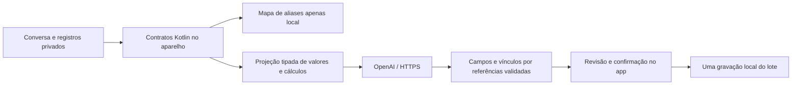

# Triagem conversacional no Android

A preview 9 reformula **Hoje → Conversar** e **Contexto → Vamos organizar seus planos?**. O agente preenche vários campos, prepara novos registros e propõe vínculos durante a conversa.
Perguntas e escolhas aparecem inline. Um resumo com **Está certo, salvar**
confirma o conjunto; formulário, tipos e contratos ficam sob **Ver o que será
guardado** e **Conexão e detalhes**, para inspeção opcional.

O fluxo anterior deixava a pessoa operar os registros e a IA só escolher uma
pergunta. Isso não atendia ao objetivo de delegar o preenchimento. O protocolo
`fintips_agente_v2` substitui esse roteador no app, mantendo o contrato v1 de
persistência e a API antiga para compatibilidade.

O usuário manteve PII exclusivamente no client e esclareceu que **valores,
relações e cálculos com labels abstratas podem ser enviados**, mas origem e
destino reais não. Essa é a fronteira implementada, também para agentes futuros.

## O que funciona

- O agente recebe os contratos dos 14 tipos e uma tabela de referências locais.
  Retorna um conjunto de campos preenchidos, novos registros, vínculos e no
  máximo uma pergunta natural, escrita pelo agente. O client restaura textos e datas sem publicá-los.
- Valores explícitos são reaproveitados: por exemplo, título entre aspas,
  dias por semana e porcentagem lida podem preencher um livro numa resposta.
  Uma referência de dias não pode virar dinheiro ou progresso. Motivos exigem
  uma referência a um motivo que a pessoa declarou.
- Correções como “na verdade, 4 dias por semana” ajustam o livro em andamento.
  Havendo mais de um candidato, uma pergunta inline resolve qual deles.
- Uma correspondência exata e única de tipo/título vira atualização, preservando
  campos não fornecidos. Semelhança textual sozinha não provoca essa fusão.
- Um único aceite confirma tudo. A confirmação continua atômica, com hash da
  base, recibos e validação completa. Conversar prepara registros, sem gravar
  alterações definitivas nas abas antes do aceite.
- Tarefas, planos, livros e tempo de uso entram nas abas existentes. Outros
  tipos vão para Anotações e **ainda não alimentam o cálculo financeiro nem sensores**.
- Novas conversas preservam a ativação do assistente e a chave. Um turno já
  processado não é reenviado ao reabrir a tela. Edições do agente não disparam
  novas chamadas; falhas não têm repetição automática na mesma sessão.

A interpretação do texto continua **local e limitada**, com vocabulário fechado
para conceitos, unidades e estrutura da frase. A sequência preserva negação,
condição e intenção; palavras não reconhecidas viram aliases `opaco_N`, sem
publicar o termo original. Não há LLM embarcado; o modelo remoto não entende
livremente cada frase pessoal. A IA agora pode executar preenchimento e
correlação de verdade, mas não se promete compreensão irrestrita da conversa.
Uma mensagem fora dessa cobertura pode precisar de esclarecimento inline.

## Chave e consentimento

Na primeira ativação, toque **Conectar minha OpenAI** na própria conversa. A janela
nativa usa campo de senha, bloqueia captura enquanto aberta e desativa autofill
nesse campo. O valor é cifrado com AES-GCM; a chave criptográfica fica no
Android Keystore. O WebView recebe apenas `configurada: true/false`, nunca a
credencial. Ela não entra em localStorage, backups do app, MCP ou relay.
É usada no header de autenticação enviado diretamente à OpenAI por HTTPS.

O endpoint é `https://api.openai.com/v1/responses`, com modelo
`gpt-4.1-mini`, Structured Outputs e `store: false`. A ativação informa quais
categorias de dados podem sair antes do diálogo da chave e vale para os
próximos turnos/conversas. **Conexão e detalhes** permite pausar, apagar/trocar a
chave ou tentar novamente. Uma consulta por turno da pessoa, sem nova chamada
provocada pelas próprias edições do agente. Cancelar uma consulta preserva os
rascunhos. A cobrança é da conta API da pessoa; nenhuma chave real foi usada nos testes.

`store: false` **não garante retenção zero**: controles de abuso e as políticas
da conta/provedor continuam aplicáveis. Valores abstratos ainda revelam aspectos
da rotina e podem ser correlacionados; não são anunciados como anônimos.

## Como o contexto atravessa a fronteira



O transporte nativo reconstrói o payload a partir dos contratos; não aceita
um JSON arbitrário do WebView para encaminhar. Só campos numéricos, booleanos
e enums declarados são publicáveis. Texto, datas exatas, IDs, nomes, títulos,
descrições, justificativas livres, origem e destino reais ficam locais. Campos
opcionais de origem/destino nem têm sua presença divulgada. Não é uma limpeza
por regex de um prompt com dados pessoais.

`item_0`, `rascunho_0`, `grupo_0`, `novo_0` e `valor_0` são referências do payload atual,
nunca hashes ou cópias dos identificadores reais. O mapa retorna ao client e
não entra no corpo HTTP. O contexto explica números com componentes verificáveis:

- objetivo: atual, meta e razão em pontos-base;
- tarefas: quantidade prevista, conclusões registradas e estado de evidência;
- leitura: cálculo existente de pacing, com amostras, intervalo, avanço e
  previsão. Datas futuras são omitidas. Ausência não é porcentagem zero.

A resposta nova usa `{registros, relacoes, pergunta}`. A pergunta tem
`{ref, campo, texto}`; menções `{{rascunho_0}}` são restauradas localmente e
referências desconhecidas são recusadas. O texto da pergunta tem até 500
caracteres e aparece como texto simples na UI. Campos são pares
`{campo, valor}`: `valor` precisa ser uma referência existente. O texto livre do modelo serve somente à pergunta. Ele não vira campo de
registro, operação de arquivo ou endpoint arbitrário. Novos
registros são limitados a seis por resposta e vinte no conjunto. Cada campo
é validado pelo catálogo antes de qualquer alteração; resposta parcialmente
inválida é recusada por inteiro. Valores explícitos numéricos não podem ser
substituídos por outro valor pelo agente; a pessoa pode corrigi-los na conversa.
A tabela tem até 512 referências; `limitado` sinaliza cortes.

O payload acrescenta códigos de conceitos e uma sequência de códigos
semânticos de vocabulário fixo, com palavras desconhecidas substituídas por
aliases, além de quantidades com unidades reconhecidas. Não publica palavras
originais fora desse vocabulário nem usa detecção de nomes como garantia. A tabela `valores_locais`, os mapas e a
conversa bruta **não** entram no HTTPS. Não é uma promessa de remoção perfeita
por regex: o texto livre nunca é publicado. Origem e destino não fornecem nem
referências. Não há redirects com credencial; erros são fixos e não ecoam
corpo remoto ou exceções.

O MCP comum de ChatGPT/Claude continua separado, com seus escopos readonly e
sua própria allowlist. A autorização da triagem não amplia permissões do MCP,
não vincula contas de chat e não envia dados ao relay.

## Contrato universal v1

Fonte única: [catálogo](../fintips/rules/triagem-catalogo.json).
[JSON Schema da proposta](contratos/triagem-v1.schema.json).
A constante Kotlin e o schema são gerados por
`scripts/gerar-contratos-triagem.py`; o CI confere a geração.

Tipos registrados: `plano`, `tarefa`, `livro`, `medida`, `objetivo`, `fato`,
`decisao`, `causa`, `compromisso`, `plano_financeiro`, `categoria`, `regra`,
`perfil` e `patrimonio`. Todos usam as mesmas operações:

| Operação | Entrada | Saída |
|---|---|---|
| `triagem.agente_contexto` | bundle, rascunhos, hoje | público abstrato, valores e mapas locais separados |
| `triagem.agente_aplicar` | bundle, rascunhos, hoje, resposta | rascunhos e relações restaurados + pergunta |
| `triagem.catalogo` | nenhuma | tipos, campos, perguntas, limites e destino |
| `triagem.contexto` | bundle, rascunhos, hoje | público abstrato + mapa apenas local |
| `triagem.preparar` | bundle, rascunhos, relações, ID do lote | proposta ligada ao hash da base |
| `triagem.validar` | bundle | validade e hash |
| `triagem.aplicar` | bundle, proposta, confirmado, hoje, tempo_ms | novo bundle e recibo; sem I/O |

Rascunhos usam `{id, tipo, campos, porque, acao}`; ação `criar` ou `atualizar`.
Atualização carrega os campos obrigatórios e preserva metadados/histórico do
registro original. Vínculos usam `{de, para, tipo, porque}` com referências
locais `{tipo, id}` existentes ou criadas no mesmo lote; tipos `apoia`,
`depende_de` e `relacionado`. Não há comando de escrita arbitrário.

O lote inclui `base_hash` SHA-256 canônico e ID. Alterar o conteúdo de um ID
já aplicado é recusado. Os últimos 256 recibos permitem retry idempotente;
fora dessa janela, a base obsoleta é recusada. A janela não limita a quantidade
de atualizações ao longo da vida do app. Dados de entrada não são mutados.
Limites desta alpha: 20 rascunhos por lote, 3.000 assets/relações locais,
100 assets e 100 opções no contexto remoto. Perguntas obrigatórias têm
prioridade antes do corte; `limitado` sinaliza truncamento.

Para um novo tipo, registre campos/unidades, perguntas e política de publicação
no catálogo, gere os contratos e acrescente casos Python ao ouro. Escolha um
adaptador de destino quando precisar alimentar uma tela/motor existente;
`caderno` fornece persistência e revisão universais, sem simular essa integração.

## API local para outros agentes

A API Python escuta no dispositivo de quem a executa, em loopback. Os contratos
são os mesmos do motor Android, com paridade cobrada pelo ouro:

```text
GET  /api/triagem/catalogo
POST /api/triagem/contexto
POST /api/triagem/preparar
POST /api/triagem/validar
POST /api/triagem/aplicar
POST /api/triagem/organizar
POST /api/triagem/agente_contexto
POST /api/triagem/agente_aplicar
POST /api/triagem/sugerir  # compatibilidade com o roteador anterior
```

Os endpoints puros devolvem o resultado em memória; **não persistem no workspace
financeiro**. O client valida/revisa e persiste o bundle completo. Essa escolha
permite usar a mesma API para qualquer tipo registrado sem criar uma segunda
regra de negócio ou uma gravação parcial em vários arquivos.

A opção `organizar` (e a antiga `sugerir`) exige `{bundle, rascunhos, hoje, confirmado_envio: true}` e a
variável local `FINTIPS_OPENAI_API_KEY`. A chave não é aceita no corpo. O processo
compila o mesmo contexto abstrato antes de fazer a chamada externa. Não
publicar esses endpoints de registros na Internet; Host e Origin estrangeiros
são recusados. A chamada exige JSON e tem corpo limitado; erros não ecoam dados.

Um agente local também pode gerar uma proposta completa e exportar JSON. No
chat Android, **Conexão e detalhes → Integrar uma proposta por contrato** importa somente rascunhos
para revisão, conferindo o hash da base atual. Só a confirmação cria registros.
A cópia em Contexto fornece o bundle local; ela contém PII e não deve ser
publicada nem enviada a um agente remoto. Agentes remotos devem trabalhar
somente com a projeção abstrata, com o client restaurando as referências.

## Persistência e compatibilidade

A primeira confirmação cria `fintips.client.v1` com vida, leitura e catálogo,
num único `localStorage.setItem`. As chaves antigas permanecem como cópias da
base anterior; os leitores e todos os editores passam a usar o documento
unificado. Quota/concorrência são conferidas antes da gravação. Remover tarefas,
planos ou livros pelos editores existentes limpa os vínculos órfãos.

A cópia local em Contexto tem formato `fintips_backup`, schema 2, incluindo
bundle e conversa, sem chave API. Se algum estado estiver corrompido, ela
exporta as strings originais das chaves conhecidas num arquivo de recuperação,
sem sobrescrever a fonte. A cópia de leitura usa sempre o estado atual.
Package, origem HTTPS do WebView e certificado permanecem os das alphas.
Desinstalar apaga o armazenamento do app; atualize por cima da anterior.

## Validação

Python é referência; o ouro novo cobra lote dos 14 tipos, atualização de
leitura preservando histórico, relações explícitas, idempotência, janela de
recibos, contexto sem PII, observação futura e recusa de fonte inválida,
confirmação ausente, base antiga ou ID reutilizado com conteúdo diferente.
Testes de transporte verificam o corpo HTTP real, credencial só no header,
consentimento, redirects e respostas fora do contrato. A instrumentação
Android exercita Keystore e HTTPS, além dos quatro casos MCP existentes.
O teste móvel usa Chromium, motor/cliente Kotlin reais e servidor HTTPS com
resposta OpenAI simulada; não equivale a chamada paga à conta do usuário.

Fontes oficiais consultadas em 15/10/2026:

- [Responses API](https://developers.openai.com/api/reference/resources/responses/methods/create).
- [Structured Outputs](https://developers.openai.com/api/docs/guides/structured-outputs).
- [Controles e retenção de dados](https://developers.openai.com/api/docs/guides/your-data).
