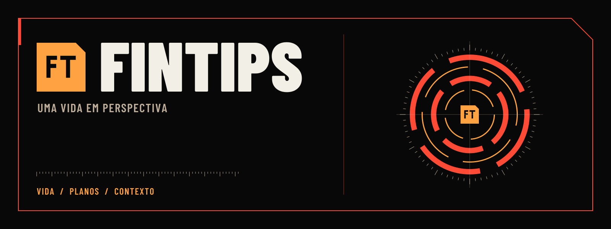

# Identidade FinTips



Kit público para README, releases, avatar, divulgação e integrações. A direção
vem dos instrumentos das interfaces de *Neon Genesis Evangelion*: preto, âmbar,
vermelho estrutural, réguas, arcos e painéis com o canto superior direito cortado
a 45°. O símbolo FT conserva os contornos do ícone Android. A palavra usa
Barlow Condensed Black, a mesma família tipográfica da interface.

## Arquivos prontos

| Uso | Arquivo | Formato / tamanho |
|---|---|---|
| Avatar / ícone externo | [icone.svg](icone.svg), `icone-{tamanho}.png` | 1024, 512, 256, 128 e 64 px, fundo preto |
| Símbolo isolado | [simbolo.svg](simbolo.svg), [simbolo.png](simbolo.png) | 512 × 512, transparente |
| Logo sobre fundo escuro | [logo-escuro.svg](logo-escuro.svg), [PNG](logo-escuro.png) | 700 × 180, transparente, letras claras |
| Logo sobre fundo claro | [logo-claro.svg](logo-claro.svg), [PNG](logo-claro.png) | 700 × 180, transparente, letras escuras |
| Uma tinta | `logo-mono-branco.{svg,png}`, `logo-mono-preto.{svg,png}` | 700 × 180, transparente |
| Cabeçalho do README | [banner-readme.svg](banner-readme.svg), [PNG](banner-readme.png) | 1600 × 600 |
| Social preview do GitHub | [banner-social.svg](banner-social.svg), [PNG](banner-social.png) | 1280 × 640 |
| Open Graph | [banner-opengraph.svg](banner-opengraph.svg), [PNG](banner-opengraph.png) | 1200 × 630 |
| Cabeçalho de release | [banner-release.svg](banner-release.svg), [PNG](banner-release.png) | 1600 × 480 |
| Campanha ilustrada | [campanha.png](campanha.png) | 2048 × 683, peça complementar |
| Favicon | [favicon.svg](favicon.svg), [favicon.ico](favicon.ico), `favicon-{16,32}.png` | ICO com 16, 32, 48 e 64 px |
| Assinatura com frase | [assinatura.svg](assinatura.svg), [assinatura-clara.svg](assinatura-clara.svg) | 1200 × 300, fundo próprio |
| Paleta | [paleta.svg](paleta.svg) | 1330 × 180 |

`marca.svg` mantém a caixa de 108 px do ícone original para referências
existentes. Para avatar novo, use `icone-512.png`: o respiro foi calculado para
o corte circular. Para favicon, use os arquivos próprios, cujo símbolo ocupa
mais espaço e conserva a leitura em 16 px.

Os logos têm fundo transparente **e FT realmente vazado**. Escolha a versão
pela cor do fundo sobre o qual ela aparecerá. Não inverta as cores de um PNG.

## Aplicação

Mantenha proporção, orientação e cores. Reserve pelo menos um quarto da altura
do símbolo entre a marca e outros elementos. Use o logo horizontal a partir de
180 px de largura; abaixo disso, prefira o símbolo. Não use animação de alerta,
glow ou sombras sobre a marca. Os arcos dos banners são ornamentais e não
representam scores, registros ou capturas do aplicativo.

Para configurar o cartão compartilhável do repositório, um administrador pode
carregar `banner-social.png` em **Settings → General → Social preview**. O
arquivo está pronto; essa configuração não é aplicada ao abrir este PR.
Para uma release, incorpore `banner-release.png` nas notas com uma URL apontando
para a tag da versão, para que sua aparência não mude com a `main`.

## Reproduzir

```bash
python3 -m venv /tmp/fintips-brand-env
/tmp/fintips-brand-env/bin/pip install -r docs/identidade/requirements.txt
/tmp/fintips-brand-env/bin/python scripts/gerar-identidade.py
```

No Linux, CairoSVG precisa da biblioteca Cairo do sistema (por exemplo,
`libcairo2` no Ubuntu). O gerador usa as duas fontes já versionadas em
`web/src/fonts/`. Toda tipografia dos SVGs é convertida em contornos; não há
`<text>`, fonte remota, JavaScript nem imagens externas. Ele funciona fora da
raiz do repo e não altera código ou assets embarcados do APK.

As versões das ferramentas estão fixadas em `requirements.txt`. SVG e PNG
podem ser regenerados; `campanha.png` é preservada pelo gerador. Não use a
ilustração de campanha como fonte para extrair o logo: a identidade canônica é
o símbolo vetorial e os quatro logos.

## Origem e licenças

Símbolo: extraído de `kotlin/app/src/main/res/drawable/ic_launcher_foreground.xml`.
Tipografia: Barlow Condensed de Jeremy Tribby, SIL Open Font License 1.1;
o aviso completo está em [web/src/fonts/OFL.txt](../../web/src/fonts/OFL.txt).
O contorno tipográfico não modifica os arquivos das fontes. Scripts e desenhos
vetoriais seguem a licença do repositório.

`campanha.png` foi criada com a ferramenta de geração de imagens do ChatGPT
para esta entrega. O briefing usou a direção visual do projeto, sem imagens de
usuários, capturas pessoais ou registros. É uma interpretação complementar da
marca; não é uma reprodução de símbolos oficiais de Evangelion.

O significado das cores e o movimento do produto estão em
[LINGUAGEM-VISUAL.md](../LINGUAGEM-VISUAL.md) e
[MOVIMENTO-UI.md](../MOVIMENTO-UI.md).
